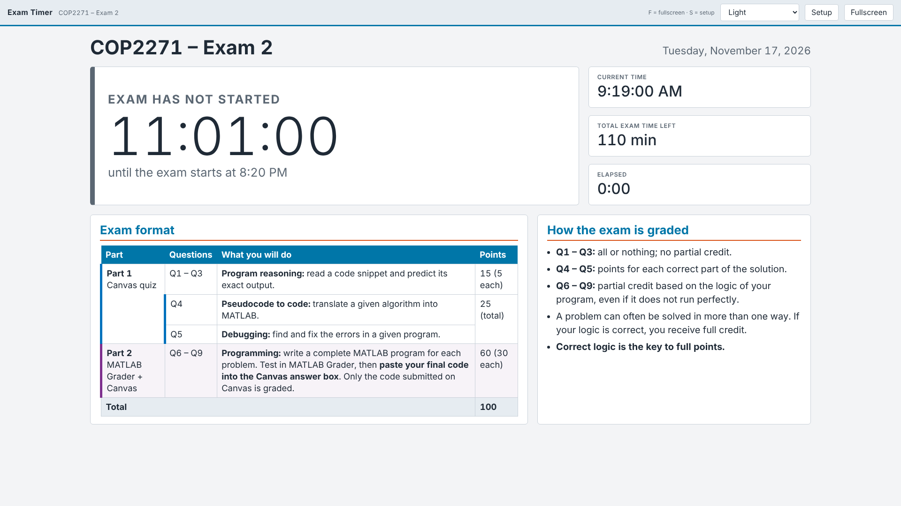

# COP2271 Exam Timer

A single-file web page for projecting the time during in-person **two-part exams** in
COP 2271 *Programming for Engineers* (MATLAB) at the University of Florida.
It shows how much time is left in the current part, the full schedule, the
Canvas access code for each part at the right moment, and the exam format while
students wait.

## Features

- **Two-part schedule.** Part 1 has a fixed length (default 45 min); Part 2 is the
  rest of the total (default 110 min, so 65 min).
- **One big countdown** for the current part, plus current time, total time left,
  and time elapsed.
- **Timeline bar and schedule table** showing each part as Done / In progress / Upcoming.
- **Calm warnings:** digits turn orange (default 10 min left in a part) and red
  (default 5 min). No flashing or sounds.
- **Transition notices:** "Part 1 time is over…" for 3 minutes after Part 1 ends,
  and "Time is up…" at the end.
- **Access codes (passwords)** for each part, shown and hidden automatically.
- **Waiting screen** with the exam format and grading rules, hidden shortly before the start.
- **MATLAB-style colors** (default plot color order and desktop chrome) with a
  Light theme and a Dark (projector) theme.
- **Accurate time:** every value comes from the computer clock, so it never drifts,
  even if the tab sleeps.
- Keeps the screen awake where the browser supports it (Screen Wake Lock API).
- Settings are saved in the browser; the date always resets to today.

## Default timeline (start 8:20 PM)

| Time | What happens |
|---|---|
| until 8:17 PM | Countdown to start + exam format and grading info |
| 8:17 PM | Info hidden; timeline and schedule shown |
| 8:18 PM | Part 1 access code appears (2 min before start) |
| 8:20 PM | Part 1 starts |
| 8:32 PM | Part 2 access code appears (12 min into Part 1) |
| 9:05 PM | Part 1 ends, Part 2 starts |
| 9:15 PM | Part 1 access code removed (10 min after Part 1 ends) |
| 10:10 PM | Exam ends; Part 2 code removed |

Every offset in this table can be changed on the setup screen.

## Usage

1. Open `index.html` in any modern browser (double-click it, or host it, see below).
2. Check the setup screen: title, date, start time, lengths, and passwords.
   The preview table shows the exact schedule and when each password appears.
3. Click **Show timer**, then press **F** for fullscreen on the projector.

| Key | Action |
|---|---|
| `F` | Toggle fullscreen (toolbar hides in fullscreen) |
| `S` | Toggle the setup screen |

## Setup fields

| Field | Default | Meaning |
|---|---|---|
| Exam title | COP2271 – Exam 2 | Shown at the top |
| Exam date / Start time | today / 20:20 | When Part 1 starts |
| Total exam length | 110 min | Part 1 + Part 2 |
| Part 1 length | 45 min | Part 2 = total − Part 1 |
| Part names | Part 1 / Part 2 | Labels used everywhere |
| Orange / red warning | 10 / 5 min | Minutes left in the current part |
| Part 1 / Part 2 password | (blank) | Blank = not shown |
| Show Part 1 password | 2 min before start | |
| Hide Part 1 password | 10 min after Part 1 ends | |
| Show Part 2 password | 12 min after start | Stays until the exam ends |
| Hide exam format info | 3 min before start | |

To change the prefilled values, edit the `DEFAULTS` object near the top of the
`<script>` in `index.html`. The exam-format text lives in the `<section id="info">`
block.

## Hosting

The page has no dependencies. To serve it from GitHub Pages: **Settings → Pages →
Deploy from a branch → `main` / root**. It will be available at
`https://<user>.github.io/<repo>/`.

## Privacy note

Passwords are typed on the setup screen and stored only in that browser's
`localStorage`. They are **not** in this repository. Clear the password fields
after the exam if the computer is shared.

## History

See [CHANGELOG.md](CHANGELOG.md).
